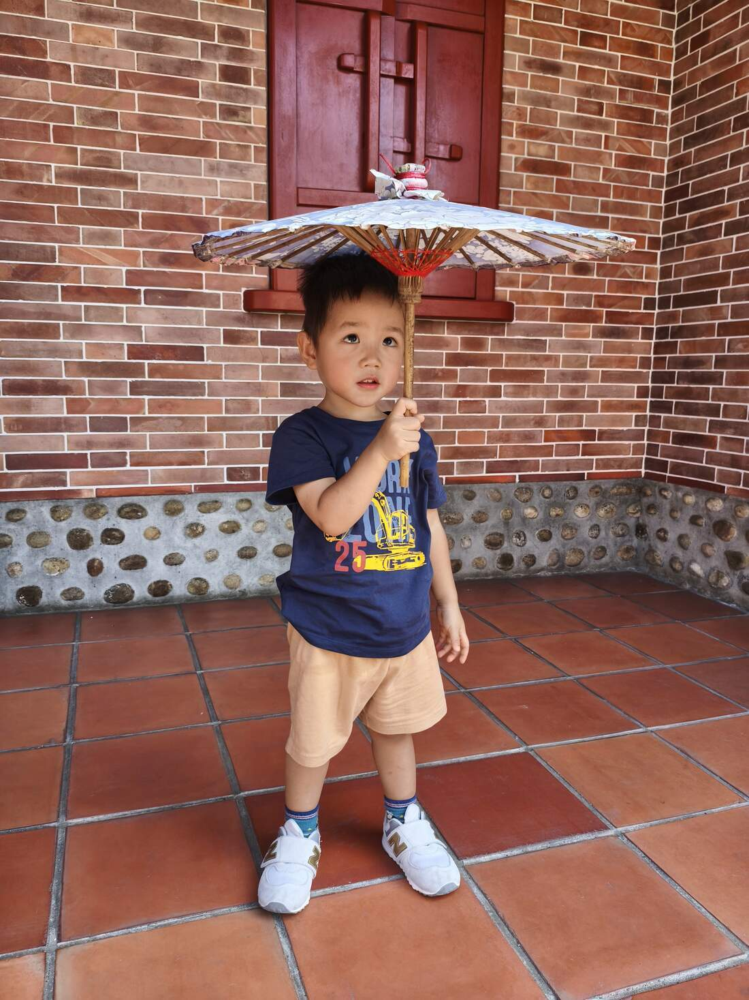
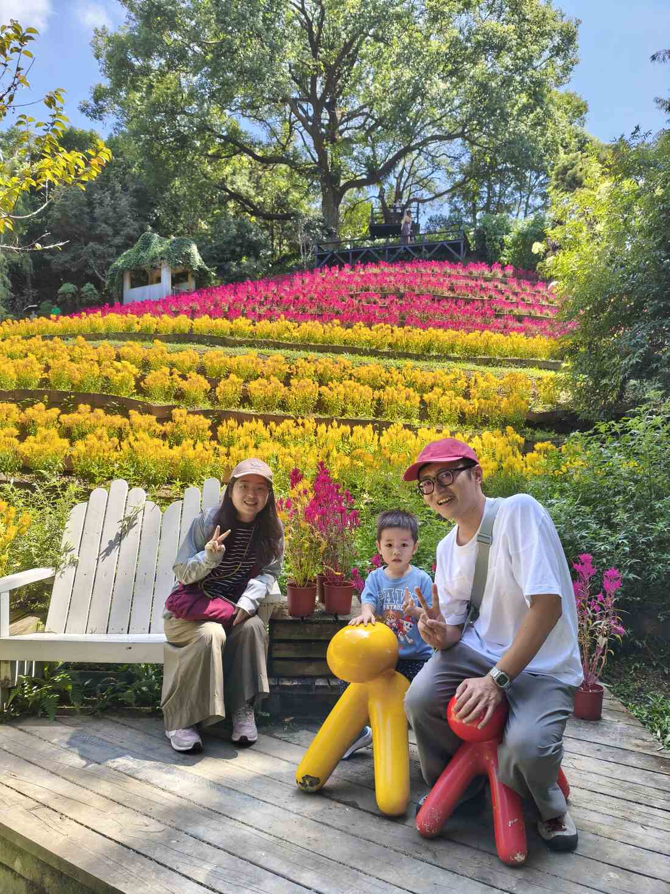
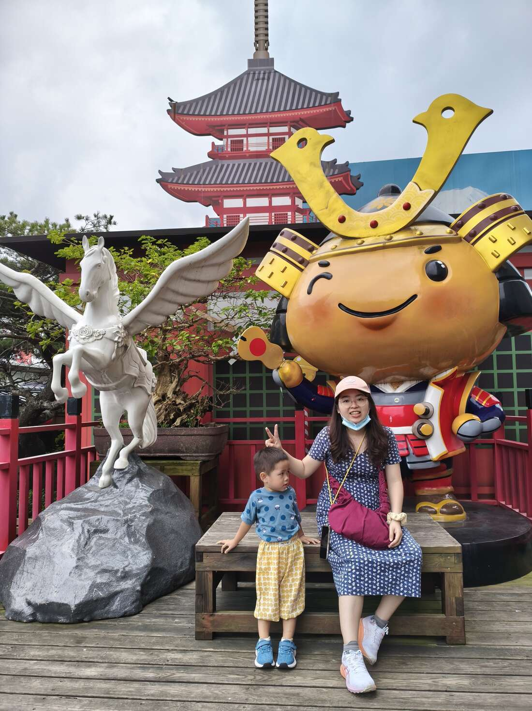
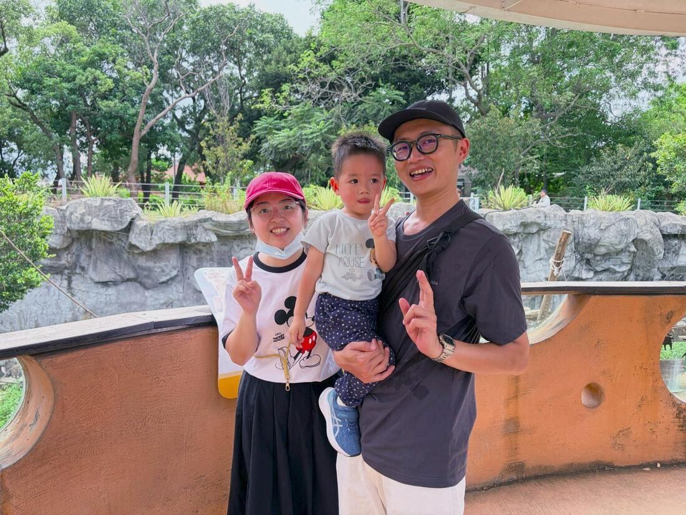
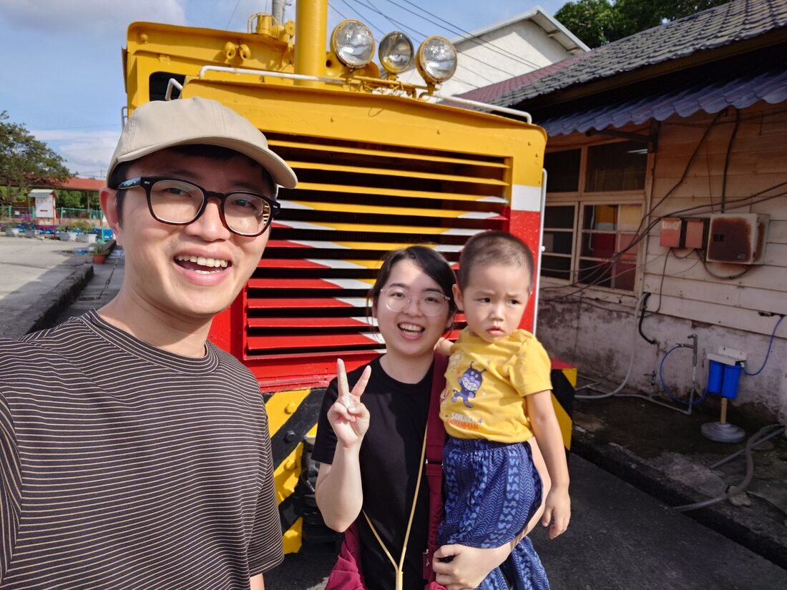
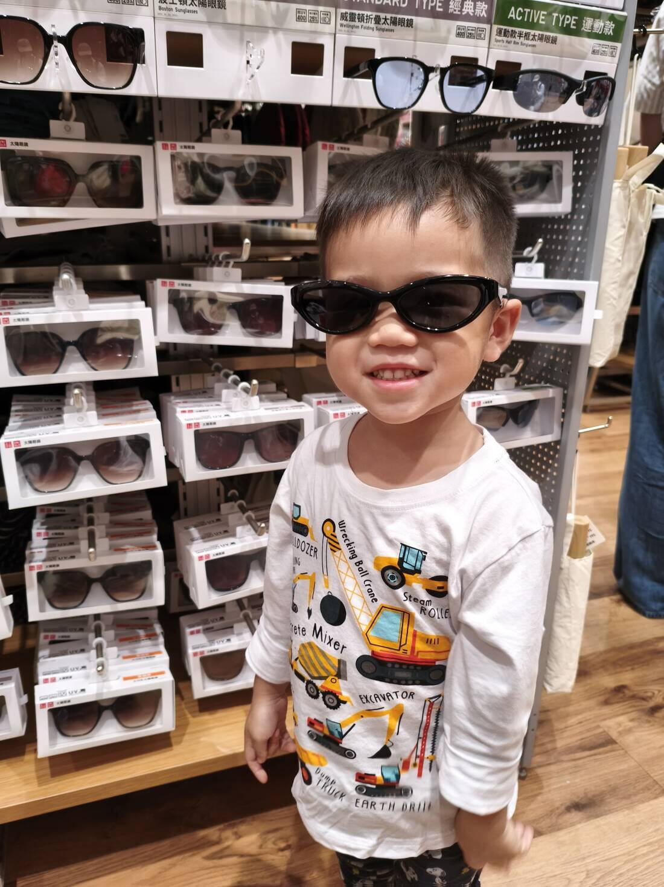
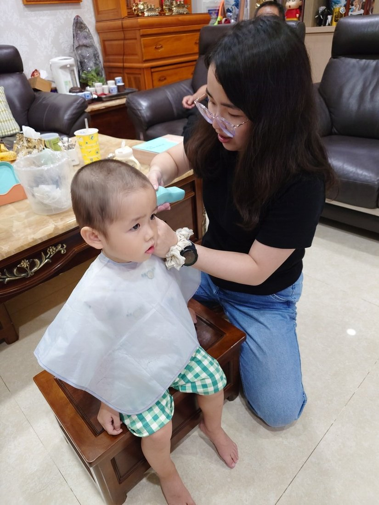
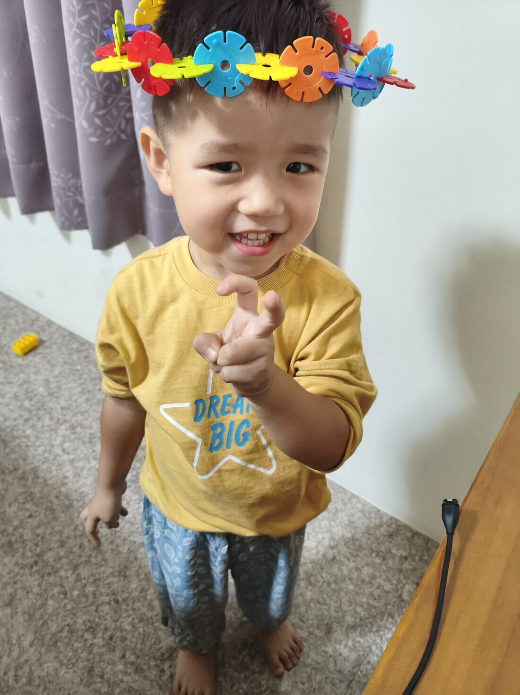
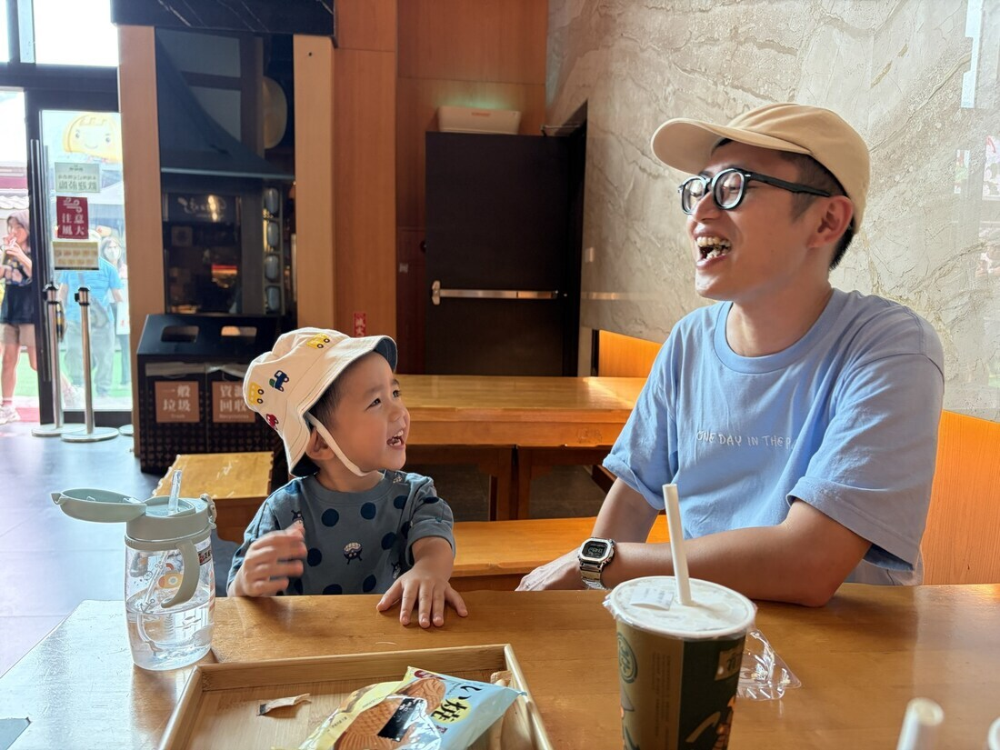
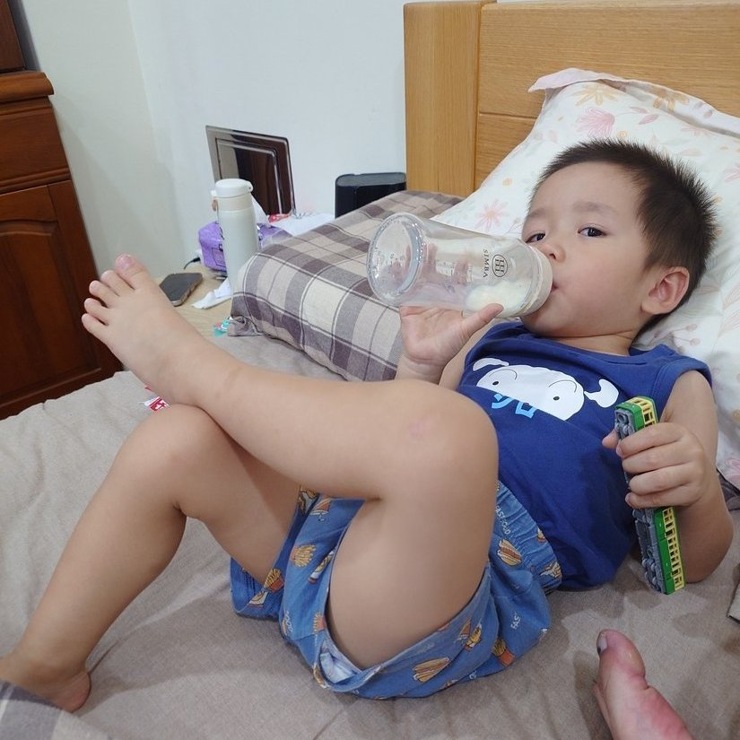

小孩長大一點以後，每個週末都要想該帶他出去哪裡晃晃，畢竟宅在家很容易搞得天翻地覆，以下簡短心得分享一下我們去哪裡，以及一點旅遊景點的評分，滿分是五顆星。

1. 成美文化園 ⭐⭐⭐⭐
   
   門票不貴，園區很大，想要認真走可以走很久，小朋友晃來晃去很適合，冰淇淋不錯吃，拍照也好看。
   
2. 薰衣草森林 ⭐⭐⭐⭐
   
   園區也不算小，吃的東西還不錯，只是路途有點遙遠在深山裡，有一些體驗課程有興趣可以嘗試看看。
   
3. 手信霧隱城 ⭐
   
   在klook上看到照片覺得還可以就去晃一晃，發現就是伴手禮專賣店，沒有什麼特別的設施可以參觀，可以說是相當無趣，但小朋友好像有地方可以晃就好了哈哈。
   
4. 新竹動物園 ⭐⭐⭐⭐⭐
   
   離市區很近的小型動物園，門票相當便宜，動物數量不多，夏天去很多都在休息，但交通便利停車方便，小朋友玩得很開心，看動物也看得很快樂，只是夏天有點熱，但因為在市區要找吹冷氣的地方都很近。
   
5. 后里糖廠 ⭐⭐
   
   國營事業台糖的老糖廠景點，可參觀的東西不多，大多就是商店販售一些全台各大老街都看得到的物品，但是是免費景點，無須停車費，也沒什麼好嫌棄了。
   

最後就隨手分享一些今年拍得照片吧！

**到Uniqlo試戴眼鏡**

**在家裡剪頭髮**

**戴上用雪花片做成的花圈很開心**

**大熱天躲到室內吹冷氣吃甜點，笑得很爽**

**霸氣翹腳喝奶**

簡短以上分享～